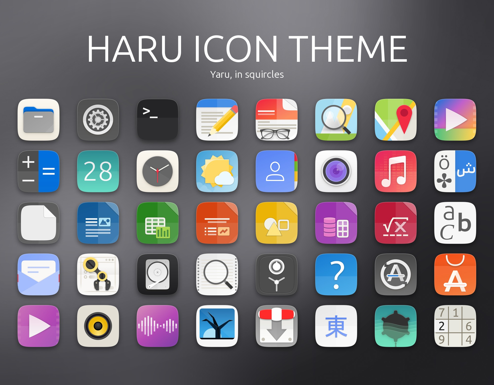
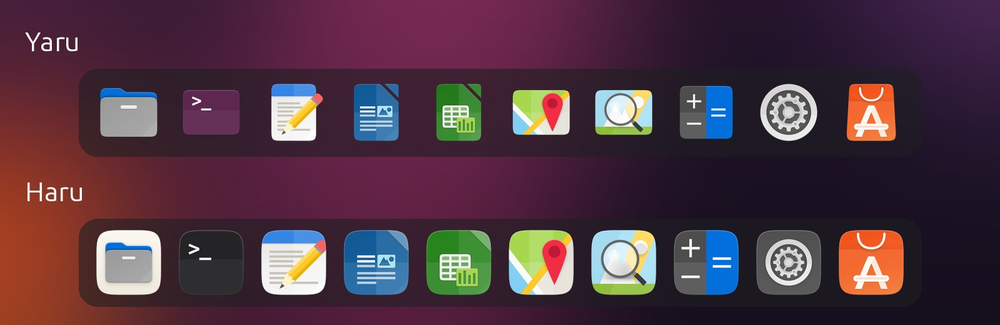
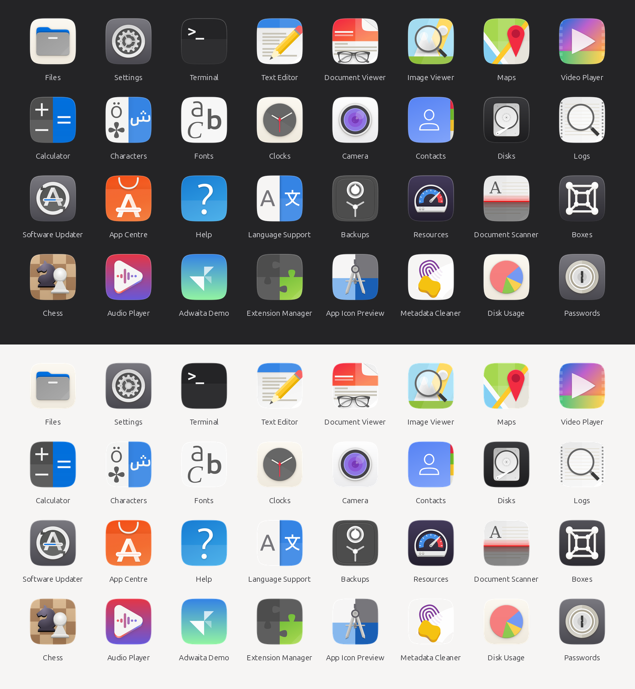

# Haru

**Yaru, in squircles.** An icon theme for Ubuntu and GNOME that keeps the
Yaru icons you know and gives every application icon the same rounded-square
shape, in the spirit of macOS.





- **Only app icons change.** Folders, file types, symbolic and status icons,
  and your GTK and Shell themes stay exactly as Yaru draws them.
- **Every app is covered,** including snaps, Flatpaks and AppImages, because
  the icons are built on your own computer from the apps you actually have.
- **Yaru's own artwork.** Many core apps (Maps, Terminal, Text Editor,
  Backups…) use Yaru's original drawings, reshaped so they fill the squircle.
  Other icons sit on a plate chosen to suit them.
- **Follows your accent colour** and light or dark style, and updates by
  itself whenever you install or remove an app.
- **No sudo, easy to undo.** Everything lives in your home folder.

## On a dark and a light desktop



## Install

You need Ubuntu (or another GNOME desktop with the Yaru icon theme installed).
On Ubuntu, the few required packages are usually already there:

```bash
sudo apt install python3-gi gir1.2-gdkpixbuf-2.0 gir1.2-rsvg-2.0 python3-cairo python3-pil yaru-theme-icon
```

Then download the [latest release](https://github.com/rsmirke/haru-icon-theme/releases/latest)
and unpack it, or clone the repository:

```bash
git clone https://github.com/rsmirke/haru-icon-theme.git
```

```bash
cd haru-icon-theme && ./install.sh
```

The first run takes about a minute while it draws your icons. If an icon in
the dock or app grid still looks old afterwards, log out and back in once.

## Uninstall

```bash
~/.local/share/haru/uninstall.sh
```

This removes the theme and its background helpers, undoes every launcher
change it made and puts back the icon theme you had before.

## How it works

1. It reads every application launcher on the system (system, `~/.local`,
   snap, Flatpak, AppImage) and finds each icon the way GNOME does, preferring
   the Yaru version.
2. Each icon becomes one of:
   - **art:** a finished drawing from `art/`, made from the original Yaru or
     app artwork so its background fills the squircle;
   - **filled:** icons that are already a full square tile are clipped to the
     squircle;
   - **disc:** round icons (Steam, Discord, Zoom, OBS…) have their disc
     carried out so it fills the squircle;
   - **logo:** everything else sits whole on a plate: warm cream by default,
     or a colour that suits the icon (grey, dark, white, a light tint of the
     icon's own colour, even a wooden chessboard for Chess).
3. All plates share one superellipse shape (n = 5, 87.5 % of the icon) with a
   hairline rim lit from the top.
4. Launchers that point to an image file instead of an icon name (common for
   snaps and AppImages) get a small override in `~/.local/share/applications`
   so the theme can reach them.
5. Two small systemd user services rebuild the theme when apps change and
   when you pick another accent colour in Settings.

Brand logos (Firefox, Proton, and so on) are never shipped in this
repository: they are drawn on your machine from the icons the apps install.

## Make it yours

Your own settings live in `~/.config/haru/config.toml` and win over
the built-in look. For example:

```toml
[overrides]
"org.gnome.Maps" = "logo"          # Maps on a plate instead of filling the squircle

[overrides."firefox_firefox"]      # icon name or launcher name
style = "logo"
plate_top = "#FFFFFF"
plate_bottom = "#EAEAEC"
```

Then rebuild:

```bash
python3 ~/.local/share/haru/haru.py generate
```

`~/.local/share/haru/contact-sheet.png` shows all your icons at a
glance, and `report.txt` lists how each one was made.

## For designers

- `config.toml`: the built-in look (shape, colours, every per-app choice).
- `art/`: finished squircle drawings.
- `tools/make-art.py`: builds drawings from Yaru's original sources.
- `tools/own-art.py`: the same for apps that are not part of Yaru.
- `tools/libreoffice-art.py`: the LibreOffice squircles.
- `tools/showcase/make.py`: redraws the images at the top of this page.
- `docs/validated-icons.md`: every approved icon and its look.

## Requests and problems

Want a hand-made squircle for an app, or something looks wrong? Open an
[issue](https://github.com/rsmirke/haru-icon-theme/issues/new/choose).

## Changes

See [CHANGELOG.md](CHANGELOG.md).

## Credits and licences

Built on the [Yaru](https://github.com/ubuntu/yaru) icon theme by the Ubuntu
community. The drawings in `art/` are derived from Yaru's artwork and from the
apps' own icons.

- Artwork: [CC BY-SA 4.0](LICENSE_CCBYSA), like Yaru's icons.
- Code and scripts: [GPL-3.0](COPYING).

Not affiliated with Canonical, GNOME or Apple.
