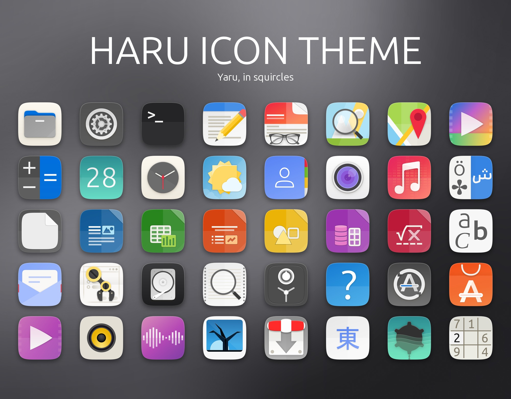

**Yaru, in squircles.** An icon theme for Ubuntu and GNOME that keeps the Yaru icons you know and gives every application icon the same rounded-square shape.



### Install

```bash
sudo apt install python3-gi gir1.2-gdkpixbuf-2.0 gir1.2-rsvg-2.0 python3-cairo python3-pil yaru-theme-icon
```

Unpack the source archive below and run `./install.sh` inside it. No sudo needed, and `~/.local/share/haru/uninstall.sh` puts everything back.

### What's in 1.0.0

- Every app icon on one squircle shape with a hairline rim; everything else stays exactly as Yaru draws it.
- 35 hand-made squircle drawings, most from Yaru's own artwork (Maps, Terminal, Evolution, Builder, all seven LibreOffice apps…).
- Round icons (Steam, Discord, Zoom, OBS Studio…) fill the squircle; other icons sit on a plate chosen to suit them.
- 99 icons reviewed and frozen (see `docs/validated-icons.md`).
- Works with snaps, Flatpaks and AppImages, follows your accent colour, and rebuilds itself when apps are installed or removed.

Want an icon improved? Open an issue with the "Icon request" template.
